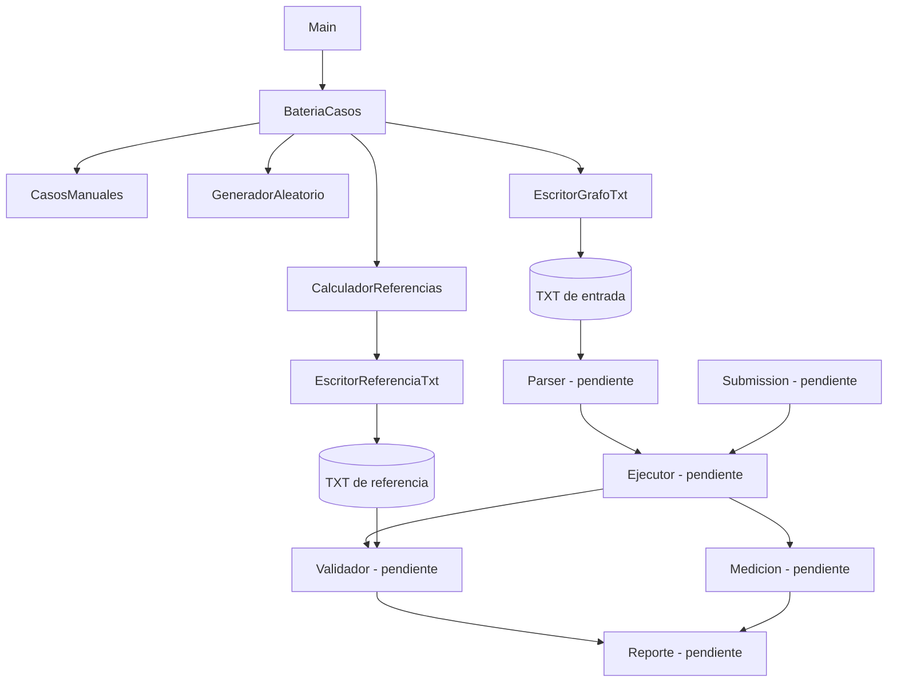
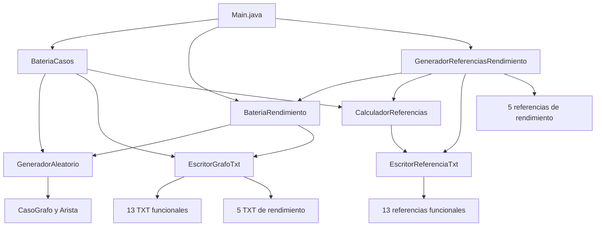
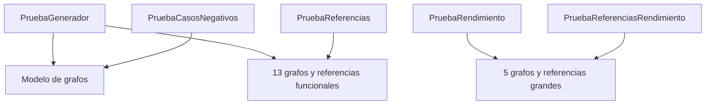

# Proyecto 13 - Arquitectura del Juez de Grafos

## 1. Objetivo

Desarrollar un framework en Java para cargar grafos,
ejecutar algoritmos entregados por estudiantes,
verificar sus resultados y medir su rendimiento.

El sistema evalua DFS, BFS, orden topologico y MST.

## 2. Arquitectura

Se utiliza una arquitectura modular orientada a objetos.

Cada componente tiene una responsabilidad definida
para facilitar el mantenimiento, las pruebas y la integracion.

## 3. Componentes

### Core

Contiene el modelo compartido del sistema.

Clases existentes:
- Arista: representa una conexion ponderada.
- TipoGrafo: identifica grafos dirigidos y no dirigidos.
- CasoGrafo: almacena vertices, aristas y metadatos.

Pendiente de integrar:
- Parser de archivos TXT.
- Contrato de soluciones de estudiantes.
- Ejecutor y medicion de rendimiento.

### Generador

Construye los casos de prueba.

Clases:
- GeneradorAleatorio
- CasosManuales
- BateriaCasos
- EscritorGrafoTxt

### Referencias

Calcula y almacena las respuestas esperadas.

Clases:
- CalculadorReferencias
- EscritorReferenciaTxt

Utiliza DFS, BFS, Kahn y Kruskal para obtener
los resultados de referencia.

### Validador

Pendiente de implementar.

Comprobara los resultados de los algoritmos,
considerando soluciones alternativas validas.

### Submission

Pendiente de implementar.

Contendra un ejemplo de implementacion estudiantil
de DFS, BFS, orden topologico y MST.

### Reporte y medicion

Pendientes de implementar.

Registraran resultados de correccion, tiempos
de ejecucion y uso estimado de memoria.

## 4. Diagrama de arquitectura

El modelo compartido del core es utilizado
por los componentes implementados en Java.

Los componentes identificados como pendientes
se integraran posteriormente.

## 5. Formatos

### Entrada

Primera linea:
TIPO V E

Lineas siguientes:
ORIGEN DESTINO PESO

D: dirigido.
U: no dirigido.

### Referencia

Se utiliza el formato REFERENCIA_V1,
documentado en contrato-formatos.md.

Incluye recorridos, distancias, estado topologico,
peso minimo y numero de componentes.

## 6. Pruebas

PruebaGenerador:
17 comprobaciones superadas.

PruebaReferencias:
14 comprobaciones superadas.

Las pruebas comprueban la generacion,
el formato y las propiedades de los grafos.

Las referencias se contrastan mediante
implementaciones independientes.

## 7. Integracion

El estudiante 1 integrara el parser,
el ejecutor y la medicion.

El estudiante 2 integrara el validador
y la submission de ejemplo.

El estudiante 3 proporciona los casos,
las referencias y la documentacion.

## 8. Estado actual

Implementado:
- Modelo de grafos.
- Generacion manual y aleatoria.
- Escritura de entradas TXT.
- Calculo de referencias.
- Escritura de referencias.
- Pruebas del generador y referencias.

Pendiente:
- Parser de entrada.
- Interfaz de submission.
- Ejecucion del codigo estudiantil.
- Validacion de soluciones.
- Medicion de rendimiento.
- Reporte integrado.

## Ampliacion de arquitectura: rendimiento y pruebas

### 1. Objetivo de la ampliacion

El modulo generador incorpora cinco grafos grandes
para preparar futuras pruebas de rendimiento.

Se conserva la separacion entre casos funcionales
y casos de rendimiento.

Ambas baterias reutilizan el modelo compartido
de grafos y los algoritmos de referencia.

### 2. Diagrama de componentes

El diagrama representa las responsabilidades
principales y el flujo general de datos.

### 3. Clases del modulo de rendimiento

| Clase | Responsabilidad |
|---|---|
| BateriaRendimiento | Define cinco casos grandes reproducibles |
| GeneradorAleatorio | Construye grafos ponderados |
| GeneradorReferenciasRendimiento | Coordina las referencias grandes |
| CalculadorReferencias | Calcula DFS, BFS, topologico y MST segun el tipo de grafo |
| EscritorGrafoTxt | Guarda grafos de entrada |
| EscritorReferenciaTxt | Guarda los resultados esperados |

### 4. Arquitectura de pruebas

Las cinco clases de prueba se encuentran
en src/test/java.

### 5. Resultados de verificacion

| Prueba | Correctas | Fallidas |
|---|---:|---:|
| Generador | 17 | 0 |
| Referencias funcionales | 14 | 0 |
| Grafos de rendimiento | 7 | 0 |
| Referencias de rendimiento | 5 | 0 |
| Casos negativos | 12 | 0 |
| Total | 55 | 0 |

Para los grafos grandes, los pesos MST
se contrastaron mediante Prim y Kruskal.

Las distancias y los ordenes BFS tambien
se compararon con una implementacion independiente.

### 6. Integracion pendiente

Esta arquitectura corresponde al modulo
de generacion, referencias y pruebas.

El proyecto completo requiere integrar
los componentes de los otros integrantes:

- Lectura y procesamiento de TXT.
- Ejecucion de soluciones estudiantiles.
- Validacion de los resultados.
- Medicion de tiempo y memoria.
- Reportes finales del juez.

La integracion debera respetar el modelo
compartido y el contrato de formatos.
