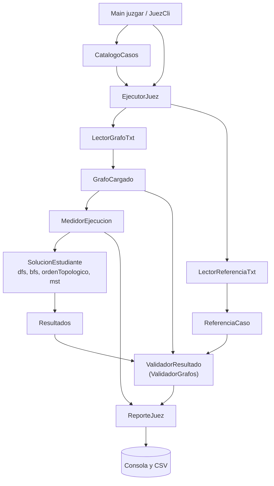

# Proyecto 13 - Core del juez (Estudiante 1)

## 1. Alcance

El core une todas las piezas del juez:

1. Lee los TXT de grafos y de referencias y los carga en memoria.
2. Define la interfaz que implementa cada solucion de estudiante.
3. Ejecuta los cuatro algoritmos y mide el tiempo de cada llamada.
4. Pide el veredicto al validador (`ValidadorGrafos`).
5. Imprime el reporte (CORRECTO / INCORRECTO y tiempo) y opcionalmente
   lo guarda como CSV.

Se apoya en el modelo compartido del Estudiante 3 (`Arista`, `CasoGrafo`,
`TipoGrafo`) y en sus carpetas `casos/`. No modifica ningun caso ni
referencia.

## 2. Flujo



Por cada caso, el ejecutor hace siempre el mismo recorrido:

1. Lee el TXT de entrada y la referencia del mismo nombre.
2. Comprueba que la referencia sea coherente con el grafo.
3. Ejecuta DFS y BFS desde el vertice `INICIO` de la referencia.
4. Ejecuta el orden topologico solo si el grafo es dirigido.
5. Ejecuta el MST solo si el grafo es no dirigido.
6. Mide cada llamada, entrega el resultado al validador y registra una fila.

Un error en un metodo, en un caso o en el validador nunca detiene al juez:
se convierte en una fila con su estado.

## 3. Paquetes y clases

| Paquete | Clase | Responsabilidad |
|---|---|---|
| `core.modelo` | `GrafoCargado` | Grafo en memoria con adyacencia inmutable |
| `core.modelo` | `Vecino` | Destino y peso de una arista de adyacencia |
| `core.parser` | `LectorGrafoTxt` | Lee `GRAFO_V1` con errores por linea |
| `core.parser` | `LectorReferenciaTxt` | Lee `REFERENCIA_V1` |
| `core.parser` | `ReferenciaCaso` | Respuestas de referencia en memoria |
| `core.parser` | `ErrorFormatoException` | Error de formato con archivo y linea |
| `submission` | `SolucionEstudiante` | Interfaz con los 4 metodos |
| `submission` | `ResultadoBFS`, `ResultadoTopologico`, `ResultadoMST` | Tipos de retorno |
| `core.ejecucion` | `MedidorEjecucion`, `Medicion` | Cronometro, timeout y captura de errores |
| `core.ejecucion` | `ConfiguracionJuez` | Calentamientos, repeticiones, limite, pila |
| `core.ejecucion` | `EjecutorJuez` | Orquesta carga, medicion y validacion |
| `core.ejecucion` | `CatalogoCasos`, `CasoPrueba` | Descubre pares entrada/referencia |
| `core.ejecucion` | `ReporteJuez` | Tabla de consola y CSV |
| `core.ejecucion` | `Algoritmo`, `EstadoEjecucion`, `ResultadoEjecucion` | Datos del reporte |
| `core` | `JuezCli` | Comando `juzgar` |
| `validador` | `ValidadorResultado`, `Veredicto`, `ValidadorGrafos` | Contrato y validador real |
| `validador` | `ValidadorPendiente` | Validador provisional (no valida; opcional) |

## 4. Lectura de grafos (GRAFO_V1)

```text
TIPO V E
ORIGEN DESTINO PESO     (exactamente E lineas)
```

El parser acepta lineas en blanco, espacios o tabuladores extra y una marca
BOM UTF-8 al inicio. Todo lo demas se rechaza con
`ErrorFormatoException`, cuyo mensaje tiene la forma
`archivo.txt:LINEA: descripcion`.

| Situacion | Linea del error |
|---|---|
| Archivo vacio o solo lineas en blanco | 0 (global) |
| TIPO distinto de `D` o `U` (se distingue mayuscula) | Encabezado |
| V menor que 1 o mayor que 2.000.000; E negativo | Encabezado |
| Encabezado sin 3 campos, o V/E no enteros | Encabezado |
| Arista sin 3 campos o con campos no enteros | La arista |
| Vertice fuera de 0 a V-1 | La arista |
| Bucle propio (origen igual a destino) | La arista |
| Peso menor que 1 o fuera del rango de `int` | La arista |
| Arista duplicada (en no dirigidos, `0 1` y `1 0` son la misma) | La segunda |
| Mas lineas de arista que E | La primera que sobra |
| Menos lineas de arista que E | 0 (global) |
| Archivo que no es UTF-8 | 0 (global) |

El nombre del caso es el nombre del archivo sin `.txt` y solo admite
letras, numeros, `_` y `-`.

### Representacion en memoria

`GrafoCargado` envuelve al `CasoGrafo` del modelo compartido y agrega las
listas de adyacencia:

| Metodo | Devuelve |
|---|---|
| `numVertices()`, `numAristas()` | V y E |
| `esDirigido()`, `tipo()`, `nombre()` | Datos del caso |
| `aristas()` | Aristas como en el archivo (una vez por arista, tambien en no dirigidos) |
| `vecinos(v)` | `List<Vecino>` ordenada por destino ascendente |

En grafos no dirigidos cada arista aparece en la lista de ambos extremos;
en dirigidos, solo en la de su origen. Las listas son inmutables.

## 5. Lectura de referencias (REFERENCIA_V1)

`LectorReferenciaTxt` devuelve un `ReferenciaCaso` con `inicio()`,
`dfsOrden()`, `bfsOrden()`, `bfsDistancias()`, `topoEstado()`,
`topoOrden()`, `mstAplica()`, `mstPeso()` y `mstComponentes()`.

- Claves obligatorias: `FORMATO`, `CASO`, `INICIO`, `BFS_ORDEN`,
  `BFS_DISTANCIAS`, `DFS_ORDEN`, `TOPO_ESTADO`, `MST_PESO`,
  `MST_COMPONENTES`. `TOPO_ORDEN` es opcional.
- Las claves desconocidas se ignoran; las repetidas se rechazan.
- `CASO` debe coincidir con el nombre del archivo.
- `MST_PESO` y `MST_COMPONENTES` aplican ambos o ninguno (`NO_APLICA`).
- `verificarCoherencia(grafo)` detecta referencias de otro caso,
  desactualizadas o que no corresponden al tipo de grafo. El juez la
  llama antes de ejecutar nada.

## 6. Contrato de la solucion de estudiante

```java
public interface SolucionEstudiante {
    int[] dfs(GrafoCargado grafo, int inicio);
    ResultadoBFS bfs(GrafoCargado grafo, int inicio);
    ResultadoTopologico ordenTopologico(GrafoCargado grafo);
    ResultadoMST mst(GrafoCargado grafo);
    default String nombre() { return getClass().getSimpleName(); }
}
```

| Metodo | Se llama en | Debe devolver |
|---|---|---|
| `dfs` | Todo grafo | Orden de descubrimiento (preorden), vecinos en orden ascendente, solo alcanzables |
| `bfs` | Todo grafo | `ResultadoBFS(orden, distancias)`; distancias de largo V, `-1` si inalcanzable |
| `ordenTopologico` | Solo dirigidos | `ResultadoTopologico.aciclico(orden)` o `ResultadoTopologico.conCiclo()` |
| `mst` | Solo no dirigidos | `ResultadoMST(aristas)`: arbol o bosque minimo |

Reglas que toda solucion debe cumplir:

- Clase publica con constructor publico sin argumentos.
- No guardar estado entre llamadas: cada metodo se ejecuta varias veces.
- No modificar el grafo recibido.
- Lanzar una excepcion o devolver `null` es `ERROR_EJECUCION`.
- Los tipos de resultado rechazan `null` y copian los arreglos al construirse.

## 7. Como se mide el tiempo

- Cada llamada corre en un hilo aparte con pila configurable.
- El cronometro (`System.nanoTime`) rodea solo la llamada al metodo de la
  solucion. No incluye lectura del TXT, armado de la adyacencia ni validacion.
- Por cada algoritmo y caso se hacen N calentamientos (se descartan, para
  que el JIT de la JVM compile el codigo) y M repeticiones medidas.
- El reporte muestra la **mediana** y el **minimo** de las repeticiones.
- El resultado que se entrega al validador es el de la primera repeticion
  medida.
- Si una ejecucion supera el limite se interrumpe el hilo y se informa
  `TIMEOUT`. Cualquier excepcion o error (incluido `StackOverflowError`) se
  captura y se informa como `ERROR_EJECUCION`.

Valores por defecto: 2 calentamientos, 5 repeticiones, 10.000 ms de limite por
ejecucion y 16 MB de pila (`ConfiguracionJuez.porDefecto()`).

## 8. Estados y reporte

| Estado | Significado | Cuenta como fallo |
|---|---|---|
| `CORRECTO` | El validador acepto la respuesta | No |
| `INCORRECTO` | El validador la rechazo (el motivo va en DETALLE) | Si |
| `SIN_VALIDAR` | Se ejecuto y midio, pero se uso `ValidadorPendiente` | No |
| `NO_APLICA` | El algoritmo no corresponde al tipo de grafo | No |
| `ERROR_EJECUCION` | La solucion lanzo una excepcion o devolvio `null` | Si |
| `TIMEOUT` | La solucion supero el limite de tiempo | Si |
| `ERROR_VALIDADOR` | El validador lanzo una excepcion | Si |
| `ERROR_CASO` | No se pudo leer el grafo o la referencia | Si |

Ejemplo de salida (con `ValidadorPendiente`, ver `--validador`):

```text
CASO       V   E  ALGORITMO  ESTADO       MEDIANA(ms)  MIN(ms)  MEM(KB)  DETALLE
01_conexo  5   7  DFS        SIN_VALIDAR        2.196    2.196      0.2  Validador sin conectar.
01_conexo  5   7  TOPOLOGICO NO_APLICA              -        -        -  Solo aplica a grafos dirigidos.
03_dag     6   6  TOPOLOGICO SIN_VALIDAR        0.460    0.460      0.6  Validador sin conectar.
```

Con un validador real, la columna ESTADO muestra `CORRECTO` o `INCORRECTO`.
La ultima linea resume la corrida: `RESULTADO: TODO CORRECTO`,
`CON FALLOS` o `SIN VALIDAR`.

El CSV (`--csv archivo`) tiene las columnas
`caso,vertices,aristas,algoritmo,estado,mediana_ns,minimo_ns,memoria_bytes,detalle`
con los tiempos en nanosegundos y la memoria en bytes (`-1` = no medido). La salida de consola usa solo ASCII para evitar
problemas de codificacion en PowerShell.

## 9. Comando juzgar

```powershell
java -cp out ec.edu.epn.eda2.juez.Main juzgar <ClaseSolucion> [opciones]
```

| Opcion | Descripcion |
|---|---|
| `--validador <Clase>` | Validador a usar (por defecto `JuezCli.VALIDADOR_POR_DEFECTO`) |
| `--casos <conjunto>` | `funcional` (por defecto, 13 casos), `rendimiento` (5) o `todos` |
| `--entrada <carpeta>` y `--referencia <carpeta>` | Carpetas propias (van juntas) |
| `--filtro <texto>` | Solo casos cuyo nombre contenga el texto |
| `--repeticiones <n>` | Repeticiones medidas (por defecto 5) |
| `--calentamientos <n>` | Ejecuciones descartadas (por defecto 2) |
| `--timeout-ms <n>` | Limite por ejecucion (por defecto 10000) |
| `--pila-mb <n>` | Pila del hilo de la solucion (por defecto 16) |
| `--csv <archivo>` | Guarda tambien el reporte como CSV |

`<ClaseSolucion>` es el nombre completo con paquete. Debe estar en el
classpath: se compila junto con el resto de `src` y se ejecuta con
`-cp out`.

Codigo de salida: `0` si no hay fallos; `1` si hay respuestas incorrectas,
errores o timeouts. `SIN_VALIDAR` no cuenta como fallo.

Ejemplo (con la submission de ejemplo `SolucionModelo`):

```powershell
java -cp out ec.edu.epn.eda2.juez.Main juzgar ec.edu.epn.eda2.juez.submission.SolucionModelo --casos todos --csv resultados.csv
```

## 10. Esqueleto de una solucion

Punto de partida para escribir una solucion. Cada metodo debe reemplazar el
`throw` por su implementacion:

```java
package ec.edu.epn.eda2.juez.submission;

import ec.edu.epn.eda2.juez.core.modelo.GrafoCargado;

public class MiSolucion implements SolucionEstudiante {

    @Override
    public int[] dfs(GrafoCargado grafo, int inicio) {
        // grafo.vecinos(v) devuelve los vecinos de v en orden ascendente
        throw new UnsupportedOperationException("pendiente");
    }

    @Override
    public ResultadoBFS bfs(GrafoCargado grafo, int inicio) {
        throw new UnsupportedOperationException("pendiente");
    }

    @Override
    public ResultadoTopologico ordenTopologico(GrafoCargado grafo) {
        throw new UnsupportedOperationException("pendiente");
    }

    @Override
    public ResultadoMST mst(GrafoCargado grafo) {
        throw new UnsupportedOperationException("pendiente");
    }
}
```

## 11. Pruebas del core

Se ejecutan desde la raiz del proyecto, despues de compilar `src` completo:

| Clase | Comprobaciones | Que cubre |
|---|---:|---|
| `core.PruebaParser` | 61 | Los 18 casos reales, adyacencia, 22 errores de formato con su linea, ida y vuelta con el escritor, referencias y coherencia |
| `core.PruebaMedidor` | 10 | Repeticiones, tiempo medido, excepciones, `StackOverflowError`, timeout, configuracion |
| `core.PruebaEjecutorJuez` | 33 | Juzgamiento completo, fallos de solucion y validador, casos invalidos, reporte, CSV y comando `juzgar` |
| **Total** | **104** | |

```powershell
java -cp out ec.edu.epn.eda2.juez.core.PruebaParser
java -cp out ec.edu.epn.eda2.juez.core.PruebaMedidor
java -cp out ec.edu.epn.eda2.juez.core.PruebaEjecutorJuez
```

`PruebaEjecutorJuez` usa soluciones y un validador **de prueba** declarados
dentro de la propia clase. Son simulacros para verificar el cableado: la
"solucion" devuelve las respuestas del archivo de referencia y el "validador"
las compara de forma exacta. No son la submission de ejemplo ni el validador
real.

## 12. Limitaciones conocidas

- **Memoria:** se mide la memoria ASIGNADA (bytes reservados por el hilo de la
  solucion en una llamada), no el pico residente. Los objetos recolectados
  durante la llamada igual cuentan. Si la JVM no soporta la medicion, se
  informa `-` en el reporte y `-1` en el CSV.
- **Sin aislamiento:** la solucion corre en la misma JVM que el juez. No hay
  sandbox: una solucion podria llamar a `System.exit` o leer archivos.
- **Ciclos infinitos:** el timeout interrumpe el hilo, pero un ciclo que ignora
  la interrupcion sigue consumiendo CPU hasta que termina la JVM. El hilo es
  demonio, por lo que no impide cerrar el programa.
- **Ruido de medicion:** los tiempos de grafos pequenos (microsegundos o pocos
  milisegundos) dependen del JIT y del sistema operativo. Para comparar
  soluciones conviene usar los casos de `rendimiento` y mas repeticiones.
- **Un solo vertice de inicio:** las referencias usan `INICIO=0`; el juez usa
  el `INICIO` de cada referencia.
